# VaultBank

VaultBank is a full-stack **simulated** banking application for a software portfolio. Customers open checking and savings accounts, move simulated Canadian dollars, and review a transaction history. Administrators search customers, freeze accounts, read an audit log, and change the savings rate.

It does not process real money, connect to a payment network, or provide banking services.

The interesting engineering problem is keeping a customer balance cache consistent with a double-entry ledger: each deposit, withdrawal, transfer, and interest posting is one PostgreSQL transaction, with row locks, idempotency keys, and database triggers that reject edits to completed ledger rows.

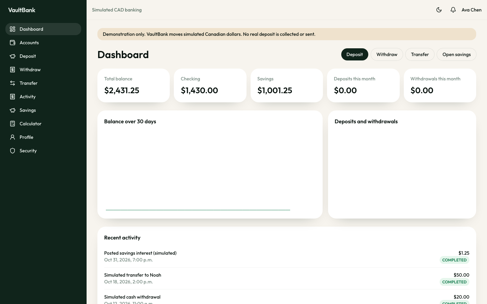

## Live Website URL

https://vaultbank-0h23.onrender.com

## Screenshots

| Landing                                               | Sign in                                           |
| ----------------------------------------------------- | ------------------------------------------------- |
| 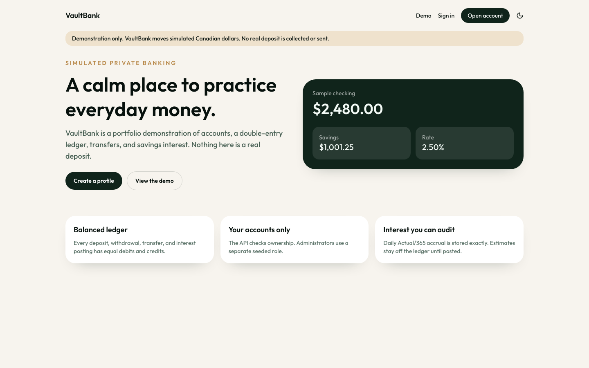 | 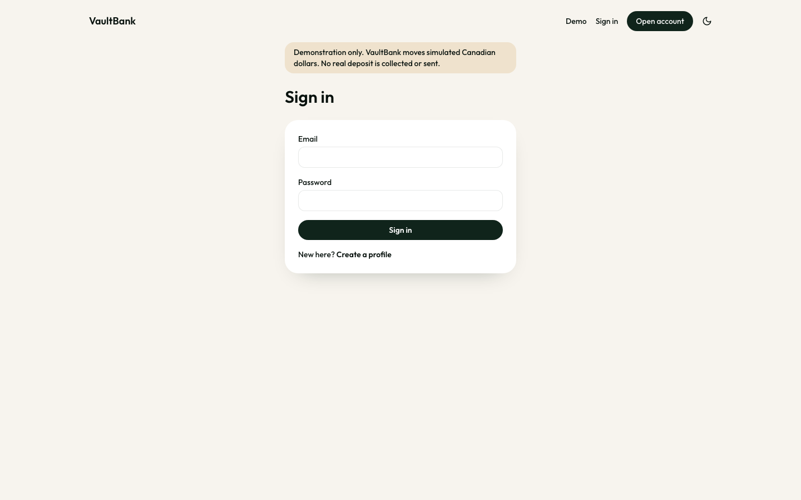 |

| Accounts                                           | Deposit                                          | Transfer                                           |
| -------------------------------------------------- | ------------------------------------------------ | -------------------------------------------------- |
| 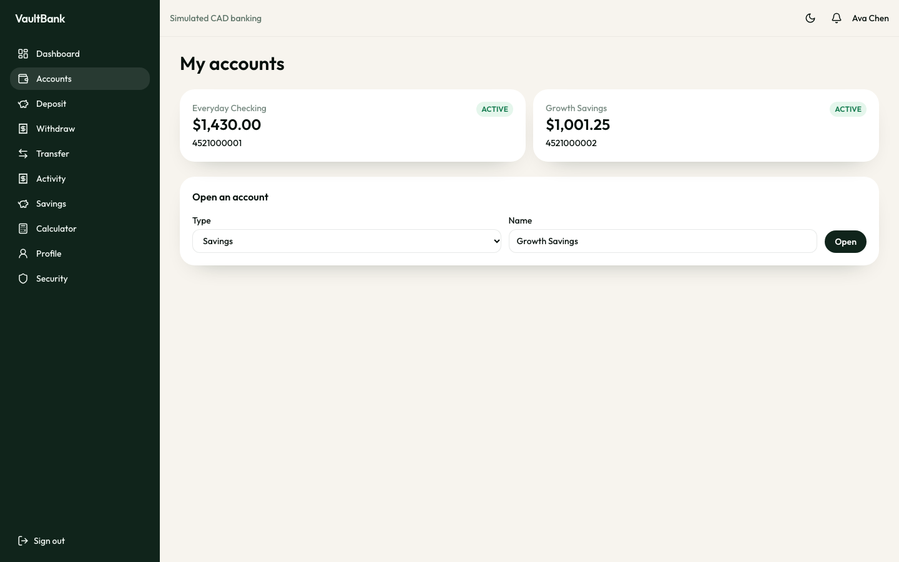 | 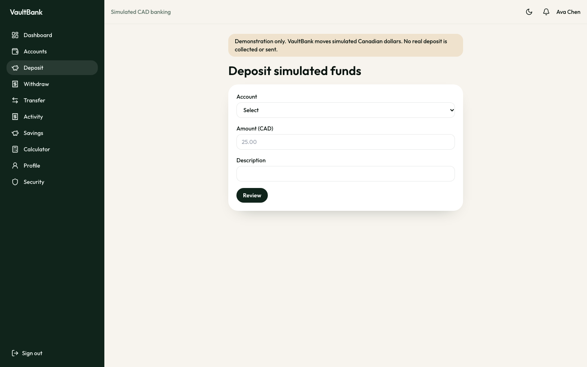 | 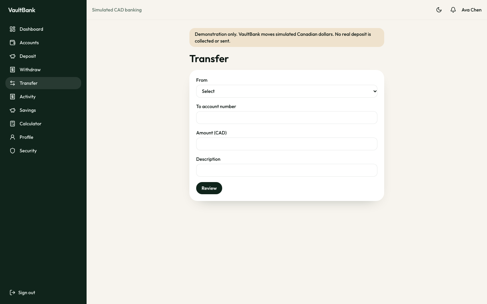 |

| Activity                                                   | Savings                                          | Administration                               |
| ---------------------------------------------------------- | ------------------------------------------------ | -------------------------------------------- |
| 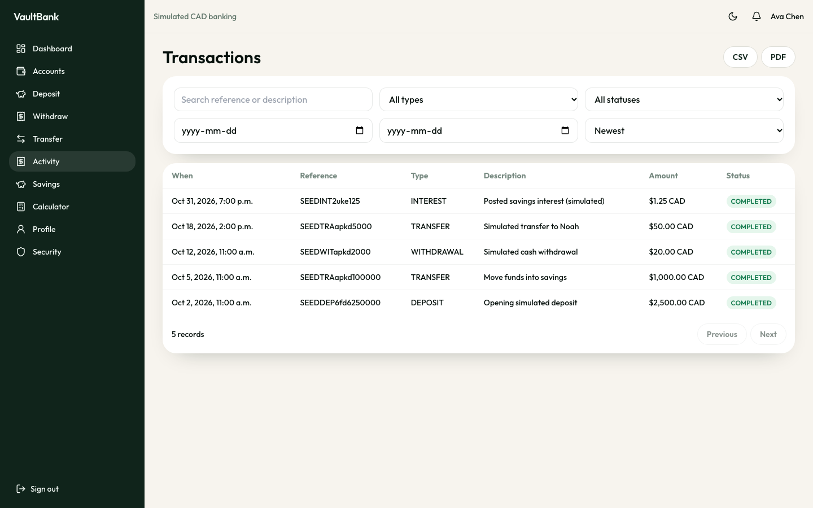 | 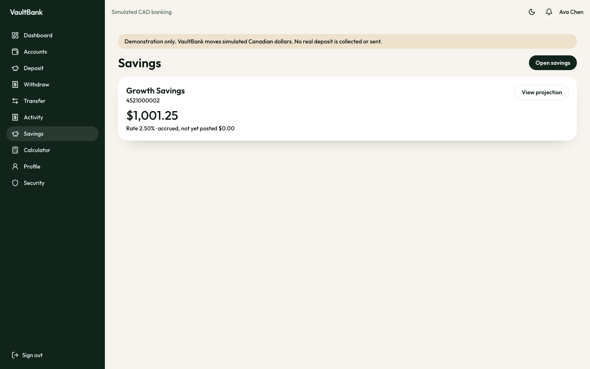 | 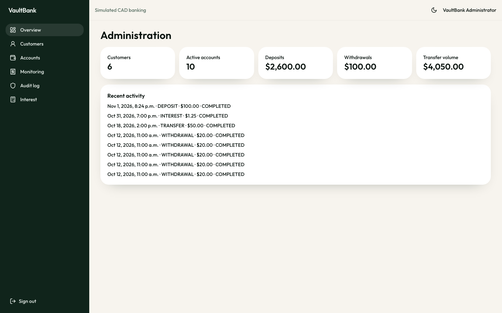 |

Mobile dashboard, open navigation, and activity:

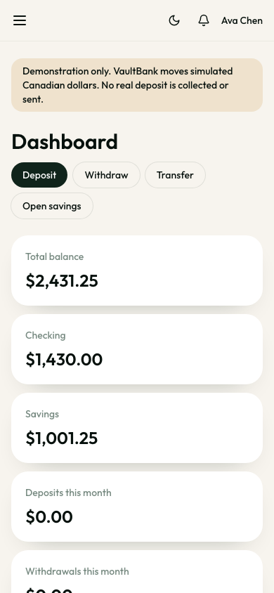
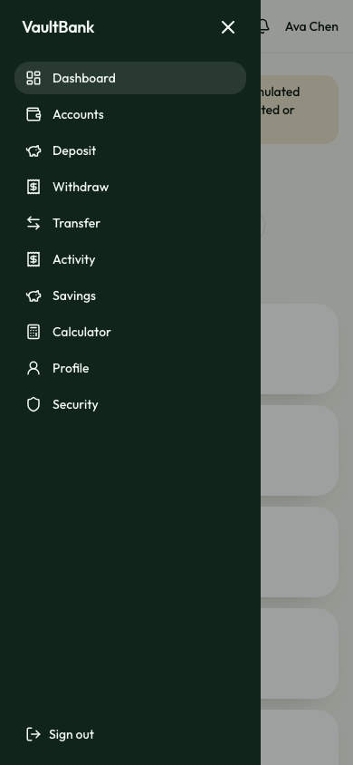
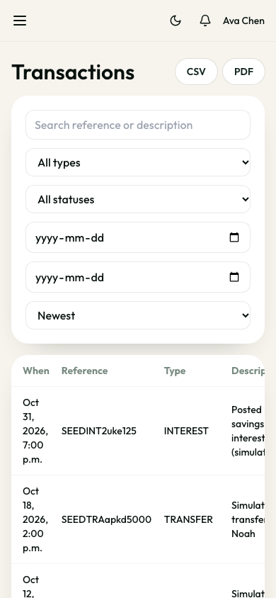

## Key features

Verified in this repository:

- Customer registration and login, with refresh-token sessions, profile updates, and password changes
- Checking and savings accounts, including opening an additional account from the app
- Simulated deposits, withdrawals, and transfers
- Transaction history with search, CSV and PDF statements
- Savings Actual/365 accrual, posted interest, and a separate growth calculator
- Administrator overview, customer search, account freeze and unfreeze, failed-attempt review, audit log, and rate changes
- Notifications, light and dark theme, and a responsive layout
- In-app copy that the balances are simulated

## Technology stack

| Area           | Choice                                                                           |
| -------------- | -------------------------------------------------------------------------------- |
| Frontend       | React 19, Vite, React Router, Axios, React Hook Form, Zod, Recharts, Lucide      |
| Styling        | Tailwind CSS                                                                     |
| Backend        | Node.js 20+, Express                                                             |
| Database       | PostgreSQL 16, Prisma                                                            |
| Authentication | bcrypt passwords, JWT access tokens, hashed refresh sessions in HttpOnly cookies |
| API protection | Helmet, CORS, Zod, `express-rate-limit`                                          |
| Statements     | CSV in process, PDFKit                                                           |
| Tests          | Mocha, Chai, Supertest; Vitest and React Testing Library; Playwright smoke test  |
| Local database | Docker Compose optional                                                          |

## System architecture

The browser talks to Express only through `/api/v1`. In development, Vite proxies `/api` to the API on port 4000. The access token stays in memory. The refresh token is an HttpOnly cookie scoped to `/api/v1/auth`. Route handlers validate input and call services. Services that move money call `postTransaction`, which opens a Prisma interactive transaction.

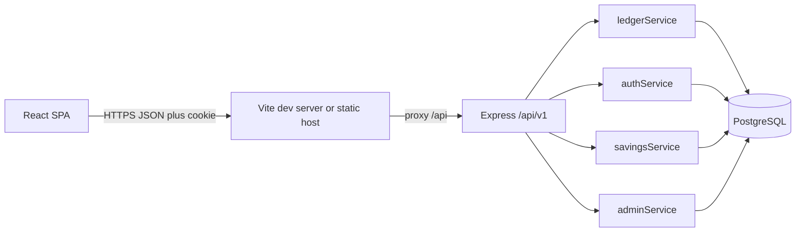

More detail is in [docs/ARCHITECTURE.md](docs/ARCHITECTURE.md).

## Database architecture

Main entities: `User`, `Account`, `Transaction`, `LedgerEntry`, `SavingsSettings`, `InterestRateHistory`, `RefreshSession`, `AuditLog`, `Notification`, and `AppSetting`.

Customer accounts are `CHECKING` or `SAVINGS`. Two system accounts, cash clearing and interest clearing, are the other side of deposits, withdrawals, and interest. A credit increases `balanceMinor`. A debit decreases it. Clearing accounts may go negative so the sum of all balances stays zero. Amounts are integer cents (`BIGINT`). The cached balance changes only in the same database transaction as the ledger rows. A trigger rejects updates and deletes of ledger entries.

See [docs/DATABASE.md](docs/DATABASE.md).

## Authentication and security

- Password policy: length, upper and lower case, a digit, and a symbol. Hashes use bcrypt.
- Login failures return one generic message. Auth and money routes are rate limited.
- Access tokens are short-lived JWTs. Refresh tokens are random, stored as SHA-256 hashes, rotated on use, and revoked on logout or password change.
- Cookie-authenticated routes require `X-Vault-Request: 1`.
- Customer queries are scoped to the signed-in user. Admin routes require `role = ADMIN`.
- Logs redact fields whose names look like passwords, tokens, cookies, or secrets.

This is not production banking-grade or financially regulated software. Limits are listed in [docs/SECURITY.md](docs/SECURITY.md).

## Financial transaction handling

| Movement        | Debit             | Credit              |
| --------------- | ----------------- | ------------------- |
| Deposit         | Cash clearing     | Customer account    |
| Withdrawal      | Customer account  | Cash clearing       |
| Transfer        | Source account    | Destination account |
| Posted interest | Interest clearing | Savings account     |

`postTransaction` locks the involved accounts with `SELECT … FOR UPDATE` in account-id order, checks status under the lock, writes the transaction and balanced ledger rows, then updates balances. A customer debit also requires `balanceMinor >= amount` in the `UPDATE`. PostgreSQL rolls the whole unit back on failure.

Clients may send `Idempotency-Key`. The unique pair is `(initiatedByUserId, idempotencyKey)`, stored with a hash of the request. The same key and same body returns the original result. The same key with a different body returns `409`.

Savings accrual uses Actual/365 and an integer numerator so fractional cents are not discarded. Whole cents post on the last UTC day of a month. The calculator does not post.

## Installation and setup

Requirements: Node.js 20 or newer, npm, and PostgreSQL 16. Docker is optional.

```bash
git clone https://github.com/manishadman/vaultbank.git
cd vaultbank

docker compose up -d
# or, with a local PostgreSQL server:
# createdb vaultbank && createdb vaultbank_test

cp .env.example backend/.env
# Set DATABASE_URL and replace both JWT secrets.

npm install
npm run db:migrate -w backend
npm run db:seed -w backend
npm run dev
```

The web app is at `http://localhost:5173`. The API is at `http://localhost:4000`. Health check: `GET /api/v1/health`.

| Variable                                   | Purpose                              |
| ------------------------------------------ | ------------------------------------ |
| `DATABASE_URL`                             | PostgreSQL connection string         |
| `TEST_DATABASE_URL`                        | Isolated database for API tests      |
| `JWT_ACCESS_SECRET` / `JWT_REFRESH_SECRET` | Signing secrets                      |
| `ACCESS_TOKEN_TTL`                         | Access token lifetime, default `15m` |
| `REFRESH_TOKEN_DAYS`                       | Refresh session lifetime             |
| `CORS_ORIGIN`                              | Allowed browser origin               |
| `COOKIE_SECURE`                            | Set `true` behind HTTPS              |
| `SEED_ADMIN_EMAIL` / `SEED_ADMIN_PASSWORD` | Development administrator            |
| `SEED_DEMO_PASSWORD`                       | Shared development customer password |
| `VITE_API_URL`                             | Frontend API base, default `/api/v1` |

Never commit `backend/.env`.

### Demo accounts

The seed refuses to run when `NODE_ENV=production` unless `SEED_ALLOW=true`. Local defaults live in `.env.example` and in the seed fallbacks. Change them before any shared deployment. Public registration cannot create an administrator.

- Administrator: `admin@vaultbank.demo`
- Customers: `ava.chen@vaultbank.demo`, `noah.patel@vaultbank.demo`, `mia.ross@vaultbank.demo`, `liam.okonkwo@vaultbank.demo`, `sofia.nguyen@vaultbank.demo`

Passwords are `SEED_ADMIN_PASSWORD` and `SEED_DEMO_PASSWORD`.

### Commands

```bash
npm run dev          # API and Vite together
npm run build        # production frontend bundle
npm test             # API tests and Vitest
npm run lint
npm run db:migrate -w backend
npm run db:seed -w backend
npm run e2e -w frontend
```

Serve `frontend/dist` as a static site and proxy `/api` to the backend, or set `VITE_API_URL` to the public API origin before building. Deployment notes: [docs/DEPLOYMENT.md](docs/DEPLOYMENT.md).

## API overview

Base path `/api/v1`. Contract: [docs/API.md](docs/API.md) and [docs/openapi.yaml](docs/openapi.yaml).

- Auth: `POST /auth/register`, `/auth/login`, `/auth/refresh`, `/auth/logout`, `GET /auth/me`
- Profile: `PATCH /profile`, `POST /profile/password`
- Accounts and dashboard: `GET /dashboard`, `GET|POST /accounts`, `GET /accounts/:id`, `GET /accounts/:id/balance`
- Money: `POST /transactions/deposit|withdraw|transfer`, `GET /transactions`, statements as CSV and PDF
- Savings: `GET|POST /savings`, `POST /savings/calculate`, projections and interest history
- Admin: dashboard, customers, accounts, freeze and unfreeze, transactions, audit logs, interest rate
- Health: `GET /health`

Request amounts are decimal strings such as `"25.00"`. Response amounts are integer cents encoded as strings.

## Testing

```bash
npm test
npm run lint
npm run build
npm run e2e -w frontend
```

API tests use `TEST_DATABASE_URL` and truncate that database. They cover registration, refresh revocation, deposits, transfers, insufficient funds, frozen accounts, idempotency, and two concurrent withdrawals. Interest and money unit tests cover Actual/365, remainder retention, and cent parsing. Frontend tests cover money formatting and a failed login. Playwright checks that the landing page identifies the simulator. Playwright expects the app on port 5173.

## Known limitations

- Simulated CAD only. No cards, external transfers, multi-currency, or real identity checks.
- No production hosting config, CI workflow, or license file yet.
- Interest uses the cached balance during accrual, not a reconstructed end-of-day balance for every past day.
- Access tokens are bearer tokens until they expire.
- The frontend production bundle is a single large JavaScript chunk.
- The Playwright smoke test does not sign in or move money.

## Future improvements

- Passkey login
- Monthly statement email
- End-of-day balance history for interest
- Code-split the frontend bundle
- Continuous integration for `npm test` and `npm run build`

## License

No license file is in the repository yet. MIT is a reasonable choice for a public portfolio.

## Documentation

- [Architecture](docs/ARCHITECTURE.md)
- [Database](docs/DATABASE.md)
- [API](docs/API.md)
- [Security](docs/SECURITY.md)
- [Deployment](docs/DEPLOYMENT.md)
